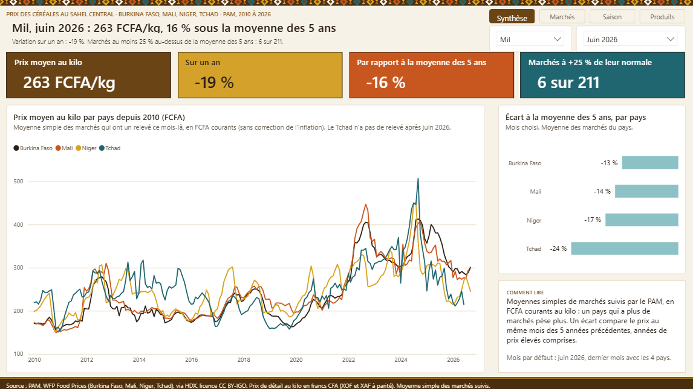
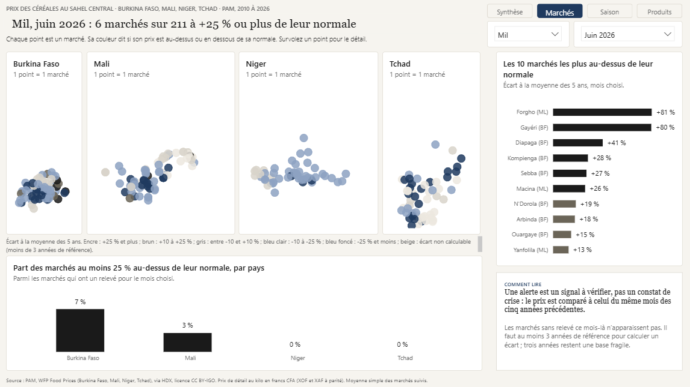
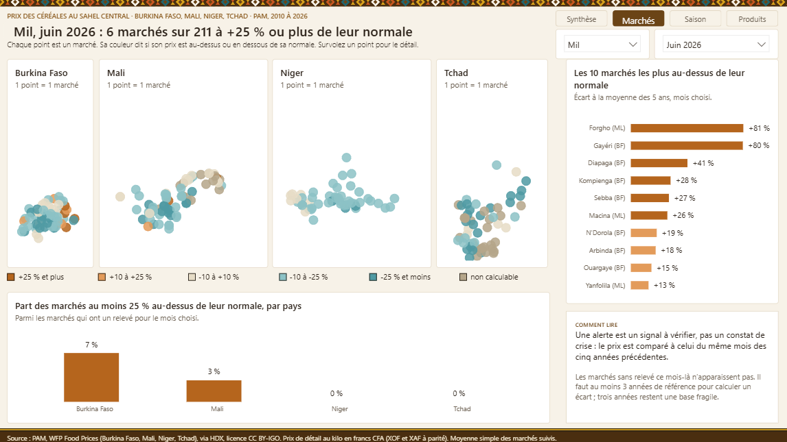
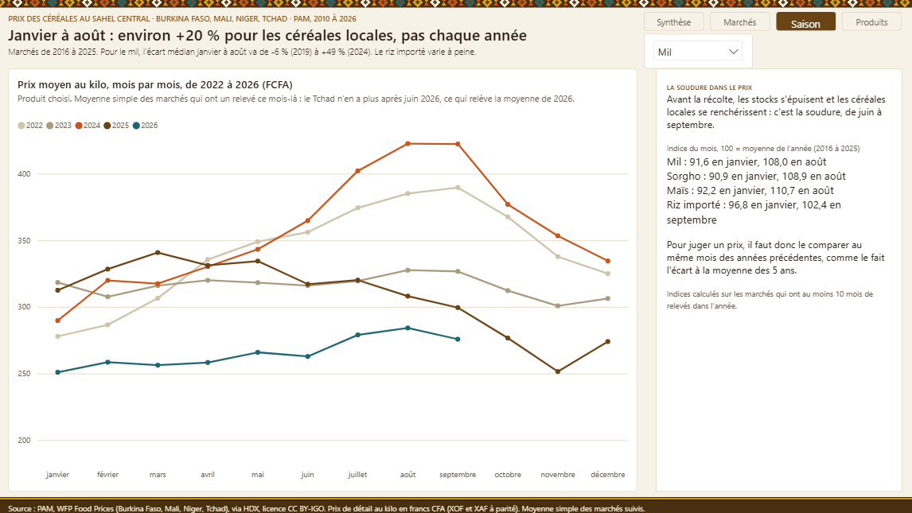

# Prix des céréales au Sahel central : tableau de bord Power BI (PAM)

> **In short (EN).** Power BI report on retail cereal prices (millet, sorghum, maize, imported and local rice) in
> Burkina Faso, Mali, Niger and Chad, built from WFP Food Prices on HDX, 2010 to September 2026. Star-schema model,
> 28 documented DAX measures, price gap against the same month's 5-year average, seasonal view, market map. Missing
> prices stay missing, never zero. Two visual identities (sober ink-on-paper, and an earth-tone Sahelian one with an
> original geometric frieze). Saved as a Power BI Project (PBIP).

**▶ [Voir la version « Terre » en ligne (Power BI, sans connexion)](https://app.powerbi.com/view?r=eyJrIjoiM2ZkNTBiMGMtZTUxNS00NjU4LWFmYTctNTEyZjY0YzEwOTBkIiwidCI6ImQwY2Y4MzcxLTBlOTAtNGQ5MC1iZDM3LTIwODg2Yzc4NGE0NCJ9)** · *Open the live report*



## La question

**Les prix des céréales sont-ils anormaux pour la saison, et dans quels marchés ?**

| Page | Question | Visuels clés |
|---|---|---|
| **Synthèse** | Quel est le prix du produit choisi, et par rapport à sa normale ? | 4 chiffres clés, courbes par pays depuis 2010, écart par pays |
| **Marchés** | Quels marchés sont au-dessus de leur normale ? | Une carte de points par pays (un point = un marché), top 10, part de marchés en alerte |
| **Saison** | Que fait la soudure aux prix ? | Un trait par année, indices saisonniers |
| **Produits** | Que coûte chaque céréale, par pays ? | Petits multiples par pays, matrice des écarts produit × pays |

Le mois et le produit se choisissent en haut de page. L'**écart à la normale** compare le prix du mois à la moyenne du même
mois sur les cinq années précédentes, pour que la hausse saisonnière de la soudure ne passe pas pour une anomalie.

## Deux identités, un même modèle

| Sobre : papier et encre (`pbip/`) | Terre : inspiration sahélienne (`pbip_terre/`) |
|---|---|
|  |  |
| Titres éditoriaux, un accent bleu, écarts en encre et bleu. | Brun, or, orange et turquoise, frise géométrique originale, tuiles en couleur. |

La frise de la version Terre est dessinée par code (`scripts/generer_motif.py`) : un motif original d'inspiration bogolan
(losanges, triangles, filets), sans reprise d'un visuel existant.



## Modèle sémantique

Schéma en étoile, mode Import, données lues depuis des CSV par Power Query.

| Table | Grain | Lignes |
|---|---|---|
| Prix | marché × produit × mois | 153 575 |
| Marché | un marché (avec coordonnées) | 354 |
| Mois | un mois, de janvier 2010 à septembre 2026 | 201 |
| Produit, Pays | dimensions | 5 et 4 |

**28 mesures DAX**, toutes décrites dans le modèle. Quelques règles :
- moyenne **simple** des marchés (un pays qui a plus de marchés pèse plus) ;
- un mois sans relevé reste vide : ni interpolation, ni zéro ;
- un écart n'est calculé que s'il y a au moins 3 années de référence.

```dax
// Marchés dont le prix dépasse de plus de 25 % la moyenne du même mois des 5 années précédentes
Marchés en alerte =
COUNTROWS (
    FILTER ( VALUES ( 'Marché'[Marché] ), [Écart à la moyenne 5 ans] > 0.25 )
) + 0
```

## Données et contrôle qualité

**Source** : *WFP Food Prices*, Programme alimentaire mondial, via HDX (licence CC BY-IGO), pour le
[Burkina Faso](https://data.humdata.org/dataset/wfp-food-prices-for-burkina-faso),
[le Mali](https://data.humdata.org/dataset/wfp-food-prices-for-mali),
[le Niger](https://data.humdata.org/dataset/wfp-food-prices-for-niger) et
[le Tchad](https://data.humdata.org/dataset/wfp-food-prices-for-chad).

Traitement (`scripts/preparer_donnees.py`) :
- prix de détail seulement, unités KG ou 100 KG ramenées au kilo, francs CFA (XOF et XAF, à parité) ;
- 5 produits, depuis janvier 2010 ; un marché-produit-mois est la moyenne des relevés du mois ;
- variations (sur un an, et par rapport à la moyenne des 5 ans) laissées vides au-delà de ±400 % (erreurs de saisie probables) ;
- contrôles : aucun prix nul ou négatif, aucun doublon marché-produit-mois.

**Limites assumées**
- Prix en FCFA **courants**, non corrigés de l'inflation ; les années de prix très élevés (2022, 2024) entrent dans la moyenne des 5 ans.
- Le Tchad n'a pas de relevé après juin 2026 : le mois par défaut est **juin 2026**, dernier mois avec les quatre pays.
- La composition des marchés change d'une année à l'autre : une moyenne de pays peut bouger sans que les prix bougent.
- Une alerte est un signal à vérifier, pas un constat de crise.

## Ouvrir le rapport

1. Installer [Power BI Desktop](https://aka.ms/pbidesktopstore) (gratuit).
2. Ouvrir `pbip/Prix Sahel.pbip` (sobre) ou `pbip_terre/Prix Sahel Terre.pbip`.
3. **Transformer les données → Modifier les paramètres** : faire pointer `Dossier données` vers le dossier `donnees/` de ce dépôt (chemin complet, terminé par `\`).
4. Cliquer sur **Actualiser**.

## Reproduire

```bash
pip install pandas pillow
python scripts/telecharger_donnees.py        # données brutes dans brut/
python scripts/preparer_donnees.py           # CSV dans donnees/
python scripts/generer_motif.py              # frise de la version Terre

node scripts/generer_modele.js               # modèle sobre
node scripts/generer_rapport.js              # rapport sobre
TERRE=1 node scripts/generer_modele.js       # modèle de la version Terre
node scripts/generer_terre.js                # rapport Terre
npx @microsoft/powerbi-report-authoring-cli validate "pbip/Prix Sahel.Report"
```

## Structure

```
donnees/          CSV préparés (prix, marchés, mois, produits, pays)
scripts/          préparation des données, génération du motif, générateurs du modèle et des rapports
pbip/             version sobre (modèle TMDL + rapport PBIR)
pbip_terre/       version Terre
ressources/       frise de la version Terre et thème de base Power BI
captures/         captures des pages des deux versions
```

## Réalisation

Conception, modèle sémantique et rapports réalisés avec l'assistance de Claude (Anthropic) et des outils agentiques
Power BI de Microsoft : préparation et contrôle des données, modèle TMDL, génération PBIR, revue des rendus par captures et
par des relectures indépendantes.

**Auteur** : KIENDREBEOGO Innocent, Ingénieur Statisticien Économiste (ISE).
[LinkedIn](https://www.linkedin.com/in/innocent-kiendrebeogo-86a3a918b/) ·
[GitHub](https://github.com/iKIENDREBEOGO1)

## Licence

Code (scripts, générateurs, définitions PBIP) : licence MIT, voir [LICENSE](LICENSE).
Données : PAM (WFP), licence CC BY-IGO, à citer avec la source ci-dessus.
